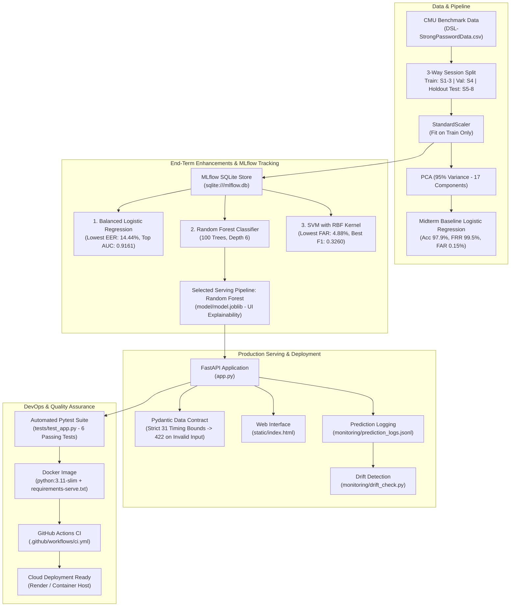

# PROJECT ARCHITECTURE & METHODOLOGY SPECIFICATION

**Project:** Machine Learning-Based User Authentication Using Keystroke Dynamics  
**Course:** CSL236 – Introduction to AI & Machine Learning, B.Tech CSE, Sem 5, The NorthCap University  
**Authoritative Midterm Baseline:** `reference/Project_Aiml.ipynb`  
**Secondary Research Reference:** `reference/midterm_notebook.ipynb`

---

## 1. Biometric Domain Fundamentals: Keystroke Dynamics

Keystroke dynamics is a behavioral biometric that measures the subconscious, habitual timing patterns of an individual typing on a physical keyboard. In the CMU Benchmark dataset (`DSL-StrongPasswordData.csv`), 51 subjects typed the identical 10-character password `.tie5Roanl` 400 times across 8 distinct sessions.

The 31 timing features are categorized into three physical keystroke intervals:

```
Key 1 Down ──[ H.key1 ]──> Key 1 Up
│                          │
│                          └──[ UD.key1.key2 ]──> Key 2 Down
│                                                 │
└───────────────[ DD.key1.key2 ]──────────────────┘
```

1. **Hold Time ($H.k$ - 11 features):** Duration in seconds a single key is depressed ($t_{\text{release}} - t_{\text{press}}$).
2. **Key-Down to Key-Down ($DD.k1.k2$ - 10 features):** Latency in seconds between pressing key 1 and pressing key 2 ($t_{\text{press}, 2} - t_{\text{press}, 1}$).
3. **Key-Up to Key-Down ($UD.k1.k2$ - 10 features):** Interval in seconds between releasing key 1 and pressing key 2 ($t_{\text{press}, 2} - t_{\text{release}, 1}$).

### Physical Domain Rule: Preserving Negative $UD$ Values
In fluent typing, a typist depresses a subsequent key *before* releasing the preceding key (key rollover / simultaneous keypresses). Under this condition:
$$t_{\text{press}, 2} < t_{\text{release}, 1} \implies UD < 0$$
**Domain Imperative:** Negative $UD$ values are physically authentic keystroke dynamics phenomena, not measurement noise or corruption. They must **never** be clipped, imputed, or treated as errors.

---

## 2. Distinction Between the Two Reference Notebooks

### A. Authoritative Midterm Implementation: `reference/Project_Aiml.ipynb`
* **Formulation:** 1-vs-All Binary User Authentication.
* **Enrolled Subject:** Subject **`s002`** is designated as the genuine account holder ($y=1$); all other 50 subjects are impostors ($y=0$).
* **Session Split:**
  - **Train Set:** Sessions `1, 2, 3, 4` ($N = 10,200$, 200 genuine, 10,000 impostor).
  - **Test Set:** Sessions `5, 6, 7, 8` ($N = 10,200$, 200 genuine, 10,000 impostor).
* **Pipeline:** 31 timing features $\to$ `StandardScaler` (fit on train, transform on test) $\to$ `PCA(n_components=0.95)` $\to$ `LogisticRegression`.
* **Baseline Baseline Evaluation (The 99% FRR Failure Mode):**
  - High overall accuracy ($97.90\%$) masks severe authentication failure: out of 200 genuine test attempts, only 2 were accepted ($TP=2$), while 198 were falsely rejected ($FN=198$, $FRR = 99.00\%$).
  - Impostor rejection was high ($TN=9984, FP=16, FAR = 0.16\%$).
  - Precision: $0.1111$, F1-score: $0.01835$, ROC-AUC: $0.8981$, EER: $18.55\%$ (at optimal threshold $\tau \approx 0.0205$).
* **Role:** Serves as the official foundational baseline and starting point for all endterm MLOps and modeling deliverables.

### B. Secondary Research Notebook: `reference/midterm_notebook.ipynb`
* **Formulation:** Multi-User Metric Learning via Deep Siamese Neural Network.
* **Architecture:** 4-layer fully connected encoder (`31 -> 128 -> 128 -> 64 -> 64`) with `nn.TripletMarginLoss(margin=1.0)` mapping all 51 subjects into a 64-dimensional $L_2$-normalized unit hypersphere.
* **Applications:** Attacker dictionary attack shortlisting and keystroke-resistant password generation.
* **Role:** Preserved intact as exploratory research for viva discussions and the literature review.

---

## 3. End-Term Production Architecture

The End-Term system expands `reference/Project_Aiml.ipynb` into a tested, containerized ML service aligned with the Brainmentors reference architecture (`mlops-starter`). 

### Production Split Protocol
1. **Training Set:** Sessions 1, 2, and 3 ($N = 7,650$; 150 Genuine, 7,500 Impostor) for model fitting.
2. **Validation Set:** Session 4 ($N = 2,550$; 50 Genuine, 2,500 Impostor) held out exclusively for Equal Error Rate (EER) threshold calibration.
3. **Holdout Test Set:** Sessions 5, 6, 7, and 8 ($N = 10,200$; 200 Genuine, 10,000 Impostor) left untouched until final unbiased evaluation.
4. **Production Serialization (Option B — Strictly Paired Pipeline):** To preserve complete methodological rigor, the serialized pipeline (`model/model.joblib`) retains the exact model instance fitted on Sessions 1–3 paired directly with the validation threshold $\tau = 0.1094$ calibrated on Session 4. We deliberately avoid refitting on Sessions 1–4 so that the deployed model and its operating threshold originate from the exact same validation procedure. The trade-off is utilizing 150 genuine repetitions rather than 200, which avoids unverified threshold transfer to a newly refitted model.

### Serving Model Selection Rationale
Random Forest (100 trees, depth 6) is serialized for production serving. It captures non-linear timing interactions and provides native tree-based feature importances (`classifier.feature_importances_`) to drive user-facing diagnostic tips in the UI. While Balanced Logistic Regression achieved our lowest overall EER (14.44%) and SVM achieved the lowest False Acceptance Rate (4.88%), Random Forest was chosen for the serving endpoint to prioritize interpretability and adhere to the workshop reference template.


