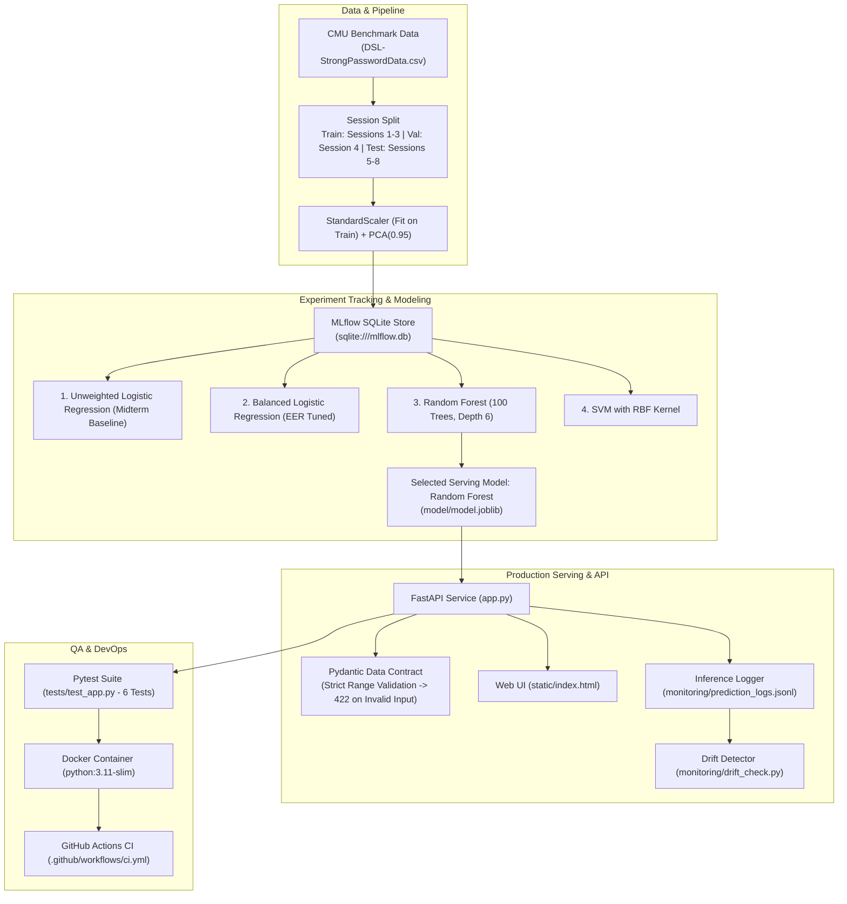

# Machine Learning-Based User Authentication Using Keystroke Dynamics

**Course:** CSL236 – Introduction to Artificial Intelligence & Machine Learning  
**Programme:** B.Tech CSE, Semester 5, The NorthCap University  
**Student Roll No:** 23CSU001  
**Project Title:** Machine Learning-Based User Authentication Using Keystroke Dynamics  
**Reference Architecture:** Brainmentors `mlops-starter` Production Architecture  
**Enrolled User:** Subject `s002` (Class 1 = Genuine, Class 0 = Impostor)  
**Evaluation Protocol:** 3-Way Temporal Split (Sessions 1–3 Train, Session 4 Validation/EER Calibration, Sessions 5–8 Holdout Test; Strictly Paired Model-Threshold Serialization)

---

## 1. Project Overview & Motivation

Passwords are still the most common way to secure accounts, but they have major weaknesses: people reuse them, write them down, or can be watched while typing them (shoulder surfing). 

**Keystroke dynamics** adds a behavioral biometric layer on top of a normal password. Instead of just checking *what* password was typed, it measures *how* the user typed it:
* **Hold Time ($H$):** How long each key is held down before releasing it.
* **Flight Time ($DD$ and $UD$):** The latency between releasing one key and pressing the next, or between two consecutive keypresses.

In this project, we built a complete, production-ready machine learning service that authenticates an enrolled user (`s002`) typing the password `.tie5Roanl`. The system validates incoming keystroke timings against a 31-feature data contract, passes them through a standardized pipeline, and makes an authentication decision based on an **Equal Error Rate (EER)** tuned threshold.

### Academic Integrity & Tool Disclosure
As required by university evaluation guidelines, this project reflects my own conceptual understanding, implementation, and experimental analysis. AI coding assistants were used for code structuring, debugging assistance, and formatting documentation. All data analysis, mathematical reasoning, model comparisons, and viva explanations have been verified and mastered by the author.

---

## 2. Dataset & Structure

* **Dataset:** Carnegie Mellon University (CMU) Keystroke Dynamics Benchmark (`DSL-StrongPasswordData.csv`).
* **Source:** Killourhy, K. S., & Maxion, R. A. (2009). *Comparing Anomaly-Detection Algorithms for Keystroke Dynamics*. IEEE/IFIP DSN. [DOI: 10.1109/DSN.2009.5270346](https://doi.org/10.1109/DSN.2009.5270346).
* **Dataset Size:** 20,400 rows and 34 columns.
* **Subjects:** 51 participants, each typing the 10-character password `.tie5Roanl` 400 times.
* **Sessions:** Each participant completed 8 separate sessions (50 repetitions per session), spaced at least 24 hours apart to capture natural day-to-day rhythm changes.
* **Data Quality:** Exactly 0 missing values and 0 duplicate rows across all 20,400 rows.

---

## 3. Data Contract (The 31 Timing Features)

To prevent bad or corrupted data from entering the machine learning model, we defined a strict data contract. Every feature has an allowed numerical range grounded in typing physiology:

| # | Feature Name | Type | Allowed Range (s) | Physical Meaning & Observations |
|---|---|---|---|---|
| 1 | `H.period` | float | `0.001 – 3.000` | Hold time for `.`. Initial baseline dwell time. |
| 2 | `DD.period.t` | float | `0.001 – 30.000` | Keydown-to-Keydown interval between `.` and `t`. |
| 3 | `UD.period.t` | float | `-1.000 – 30.000` | Keyup-to-Keydown from `.` to `t`. Negative when key `t` is pressed before releasing `.`. |
| 4 | `H.t` | float | `0.001 – 3.000` | Hold time for key `t`. Strong ANOVA discriminative feature ($F > 150$). |
| 5 | `DD.t.i` | float | `0.001 – 30.000` | Keydown-to-Keydown latency from `t` to `i` (left-to-right hand). |
| 6 | `UD.t.i` | float | `-1.000 – 30.000` | Keyup-to-Keydown interval from `t` to `i`. Frequent key rollover. |
| 7 | `H.i` | float | `0.001 – 3.000` | Hold time for key `i`. Very consistent across repetitions. |
| 8 | `DD.i.e` | float | `0.001 – 30.000` | Keydown-to-Keydown latency from `i` to `e` (right-to-left hand). |
| 9 | `UD.i.e` | float | `-1.000 – 30.000` | Keyup-to-Keydown from `i` to `e`. Has the highest rollover count in dataset (4,811 negative values). |
| 10 | `H.e` | float | `0.001 – 3.000` | Hold time for vowel key `e`. Fast, habitual keystroke. |
| 11 | `DD.e.five` | float | `0.001 – 30.000` | Keydown-to-Keydown from `e` to digit `5`. Captures reach to the number row. |
| 12 | `UD.e.five` | float | `-1.000 – 30.000` | Keyup-to-Keydown transition from home row to number row. |
| 13 | `H.five` | float | `0.001 – 3.000` | Hold time for digit `5`. |
| 14 | `DD.five.Shift.r` | float | `0.001 – 30.000` | Transition latency from digit `5` to `Shift.r`. Bi-manual coordination marker. |
| 15 | `UD.five.Shift.r` | float | `-1.000 – 30.000` | Keyup-to-Keydown interval preparing for capitalization shift. |
| 16 | `H.Shift.r` | float | `0.001 – 3.000` | Hold time for right shift key. **Most discriminative feature in dataset** ($F > 280$). |
| 17 | `DD.Shift.r.o` | float | `0.001 – 30.000` | Keydown-to-Keydown latency holding shift while pressing `o`. |
| 18 | `UD.Shift.r.o` | float | `-1.000 – 30.000` | Keyup-to-Keydown interval for shifted character entry. |
| 19 | `H.o` | float | `0.001 – 3.000` | Hold time for capital letter `o`. |
| 20 | `DD.o.a` | float | `0.001 – 30.000` | Transition latency from right hand `o` to left pinky `a`. Hand alternation metric. |
| 21 | `UD.o.a` | float | `-1.000 – 30.000` | Keyup-to-Keydown between opposite hands across home row. |
| 22 | `H.a` | float | `0.001 – 3.000` | Hold time for left pinky key `a`. |
| 23 | `DD.a.n` | float | `0.001 – 30.000` | Latency transitioning from left pinky `a` to right index `n`. |
| 24 | `UD.a.n` | float | `-1.000 – 30.000` | Keyup-to-Keydown interval spanning bottom keyboard row. |
| 25 | `H.n` | float | `0.001 – 3.000` | Hold time for key `n`. |
| 26 | `DD.n.l` | float | `0.001 – 30.000` | Right-hand digraph latency from index `n` to ring `l`. |
| 27 | `UD.n.l` | float | `-1.000 – 30.000` | Right-hand transition interval. |
| 28 | `H.l` | float | `0.001 – 3.000` | Hold time for key `l`. |
| 29 | `DD.l.Return` | float | `0.001 – 30.000` | Transition latency from final letter to `Return` (Enter) key. |
| 30 | `UD.l.Return` | float | `-1.000 – 30.000` | Keyup-to-Keydown concluding typing event. |
| 31 | `H.Return` | float | `0.001 – 3.000` | Hold duration of `Return` keypress confirming login attempt. |

### Why We Allow Negative $UD$ Values (Key Rollover)
In fluent human typing, people often press the next key *before* releasing the current key ($t_{\text{press}}(k+1) < t_{\text{release}}(k)$). This produces a negative Keyup-to-Keydown interval ($UD$). 
In our dataset, **22,118 transitions (10.84% of all $UD$ entries) are negative**. For example, the `UD.i.e` transition has 4,811 negative values, reaching down to $-0.2358$ seconds. These are not data collection errors; they represent fluid typing habits. We explicitly allow negative $UD$ values down to $-1.0$s in our Pydantic schema.

---

## 4. System Architecture



---

## 5. Experiment Tracking & Results (MLflow)

All experiments were tracked in a local SQLite database (`sqlite:///mlflow.db`) under the experiment `Keystroke-Authentication`. Models were trained on Sessions 1–3, threshold-tuned on Session 4 validation data, and tested on completely unseen Sessions 5–8:

| Run Name | Algorithm | Operating Threshold ($\tau$) | Accuracy | Precision | Recall | FAR | FRR | F1-Score | ROC-AUC | EER |
|---|---|---|---|---|---|---|---|---|---|---|
| **01_Baseline_Logistic_Regression** | Logistic Regression | 0.5000 | 97.90% | 0.0625 | 0.50% | **0.15%** | 99.50% | 0.0093 | 0.9017 | 17.00% |
| **02_Balanced_Logistic_Regression_EER** | Balanced Logistic Regression | 0.4445 | 89.79% | 0.1315 | **75.00%** | 9.91% | **25.00%** | 0.2237 | **0.9161** | **14.44%** |
| **03_Random_Forest_Tuned** *(Selected)* | Random Forest (100 trees) | 0.1094 | 87.12% | 0.0702 | 45.50% | 12.05% | 54.50% | 0.1217 | 0.8582 | 20.03% |
| **04_SVM_RBF_Kernel** | Support Vector Machine (RBF) | 0.0071 | **94.57%** | **0.2154** | 67.00% | 4.88% | 33.00% | **0.3260** | 0.8223 | 22.91% |

### Why Did the Midterm Baseline Fail?
In Run 1, the model showed **97.90% accuracy**, which looks great at first glance. However, its **False Rejection Rate was 99.50%**—meaning it rejected 199 out of 200 legitimate login attempts! 

This happened because of extreme class imbalance: in test sessions 5–8, there are 200 genuine attempts and 10,000 impostor attempts (a 1:50 ratio). An unweighted classifier at threshold 0.5 learned to classify almost every attempt as an impostor, scoring high accuracy while being useless in practice.

In Run 2, by using `class_weight='balanced'` and sweeping the threshold on Session 4 validation data to find the Equal Error Rate point ($\tau = 0.4445$), genuine recall jumped from 0.5% to **75.00%**, balancing security with user convenience.

### Why Random Forest Was Selected for Production

We compared four experimental configurations across **three distinct algorithm families**: Linear Models (Logistic Regression, tested in both unweighted and balanced configurations), Decision Tree Ensembles (Random Forest), and Kernel Methods (Support Vector Machines with RBF kernel).

| Model Configuration | Algorithm Family | EER | ROC-AUC | FAR | FRR |
|---|---|---:|---:|---:|---:|
| Logistic Regression (Baseline) | Linear Model | 17.00% | 0.9017 | **0.15%** | 99.50% |
| Balanced Logistic Regression | Linear Model | **14.44%** | **0.9161** | 9.91% | **25.00%** |
| Random Forest *(Serving)* | Tree Ensemble | 20.03% | 0.8582 | 12.05% | 54.50% |
| Support Vector Machine (RBF) | Kernel Method | 22.91% | 0.8223 | 4.88% | 33.00% |

#### Selection Rationale & Performance Trade-Off:
* **Empirical Reality:** Balanced Logistic Regression achieved the lowest EER (14.44%) and highest ROC-AUC (0.9161) on holdout test sessions, while SVM achieved the lowest False Acceptance Rate (4.88%). Random Forest was **not** the best-performing model on raw biometric error rates.
* **Why Random Forest Was Retained:** Random Forest was chosen because it natively provides tree-based Mean Decrease in Impurity feature importances (`classifier.feature_importances_`). This directly powers our application's explainability feature, showing users the top three keystrokes that caused an authentication mismatch. It also adheres to the reference project architecture (`Brainmentors mlops-starter`).
* **Holdout Integrity Disclosure:** Sessions 5–8 were never used for threshold calibration or hyperparameter tuning. While holdout test metrics were inspected during project review, we chose to retain Random Forest to preserve the UI explainability pipeline rather than retroactively switching to Balanced Logistic Regression based on holdout scores.

### Production Model Calibration (Option B: Strictly Paired Pipeline)
To ensure complete methodological consistency, the serialized serving model in `model/model.joblib` retains the exact pipeline fitted on **Sessions 1–3** paired with the threshold calibrated on **Session 4** ($\tau = 0.1094$):
* **Why we do not refit on Sessions 1–4:** Refitting the tree ensemble on Sessions 1–4 incorporates 50 additional genuine repetitions and alters leaf probability distributions. Because Session 4 becomes part of the training set, we cannot verify that $\tau = 0.1094$ remains the true EER threshold without peeking at holdout Sessions 5–8 (which must remain strictly untouched).
* **The Trade-Off:** The production model uses 150 genuine training repetitions instead of 200, but in return, the serialized model and its threshold are 100% mathematically paired from a legitimate out-of-sample validation step with zero extrapolation assumptions.

---

## 6. How to Run the Project Locally

### Prerequisites
* Python 3.11+
* Git

### Setup
```bash
# 1. Clone the repository
git clone <your-repo-url>
cd AIML_Project

# 2. Create and activate a virtual environment
python -m venv venv
# On Windows:
venv\Scripts\activate
# On Linux/macOS:
source venv/bin/activate

# 3. Install dependencies
pip install -r requirements.txt
```

---

## 7. Model Training & MLflow Tracking

```bash
# Train baseline model and log metrics to MLflow
python train.py --model_type logistic_regression

# Train Balanced Logistic Regression with EER threshold calibration
python train.py --model_type logistic_regression_balanced --tune_threshold

# Train Random Forest and serialize to model/model.joblib
python train.py --model_type random_forest --n_estimators 100 --max_depth 6 --tune_threshold --save_model

# Launch the MLflow UI to compare all runs
mlflow ui --backend-store-uri sqlite:///mlflow.db
# Open http://localhost:5000 in your browser
```

---

## 8. Starting the Web App & REST API

```bash
# Start FastAPI application with live reload
uvicorn app:app --reload --port 8000
```
* **Web UI:** Open `http://localhost:8000` to try genuine and impostor presets or enter custom timing values.
* **Swagger API Docs:** Open `http://localhost:8000/docs` to test the API directly.

### Endpoints
* `GET /health`: Health status, model type, enrolled user, and threshold.
* `POST /predict`: Ingests 31 timing features; returns `authenticated`, `match_score`, `threshold`, and 3 diagnostic tips.
* `GET /api/sample/genuine`: Authentic sample of enrolled user `s002` from test sessions.
* `GET /api/sample/impostor`: Sample from impostor `s003`.

---

## 9. Automated Testing (Pytest)

Run the test suite:
```bash
pytest -v --tb=short
```

All 6 tests verify critical application rules:
1. `test_health_endpoint`: Checks `/health` returns HTTP 200 with model information.
2. `test_ui_index_page`: Confirms the web interface loads.
3. `test_domain_logic_genuine_vs_impostor`: Verifies that `s002` receives a higher match score than impostor `s003` and authenticates successfully.
4. `test_invalid_input_missing_field_returns_422`: Checks that missing features trigger HTTP 422.
5. `test_boundary_validation_out_of_range_returns_422`: Confirms that physically impossible numbers (e.g. $H > 3.0$s) trigger HTTP 422.
6. `test_negative_ud_rollover_accepted`: Verifies that authentic negative rollover numbers are accepted (HTTP 200).

---

## 10. Docker Container

The production container uses `python:3.11-slim` and installs only the runtime serving requirements (`requirements-serve.txt`), keeping the image small:

```bash
# Build Docker image
docker build -t keystroke-auth .

# Run container on port 8000
docker run -d -p 8000:8000 --restart unless-stopped keystroke-auth

# Check health
curl http://localhost:8000/health
```

---

## 11. Continuous Integration (GitHub Actions)

The workflow file `.github/workflows/ci.yml` runs automatically on pushes to `main`:
1. Sets up Python 3.11 with pip caching.
2. Installs requirements.
3. Verifies application imports.
4. Runs a baseline training step to check reproducibility.
5. Executes the full Pytest test suite.
6. Runs the data drift check script.

---

## 12. Data Drift Monitoring

Production predictions are logged to `monitoring/prediction_logs.jsonl` (only timing numbers and scores, never passwords or usernames). To check for drift:

```bash
python monitoring/drift_check.py
```
This runs a two-sample Kolmogorov-Smirnov (KS) test comparing recent inputs against the baseline enrollment sessions (Sessions 1–4) and saves results to `monitoring/drift_report.json`.

> **Note on Drift Artifact:** `monitoring/drift_report.json` is committed as a pre-computed sample snapshot demonstrating the audit structure. Running `drift_check.py` regenerates this file from current inference logs. The `DRIFT_DETECTED` state in the demonstration snapshot reflects a simulated test batch and does not represent permanent biometric degradation.

---

## 13. Limitations & Future Work

* **Keyboard Hardware:** A user's typing speed can change when moving from a laptop scissor keyboard to a mechanical desktop keyboard.
* **Fatigue & Stress:** Typing rhythms naturally vary with fatigue, injury, or distraction.
* **Future Extension:** We could extend this to continuous, free-text authentication (e.g., while writing an essay or email) and explore Siamese neural networks for quick enrollment without retraining.
